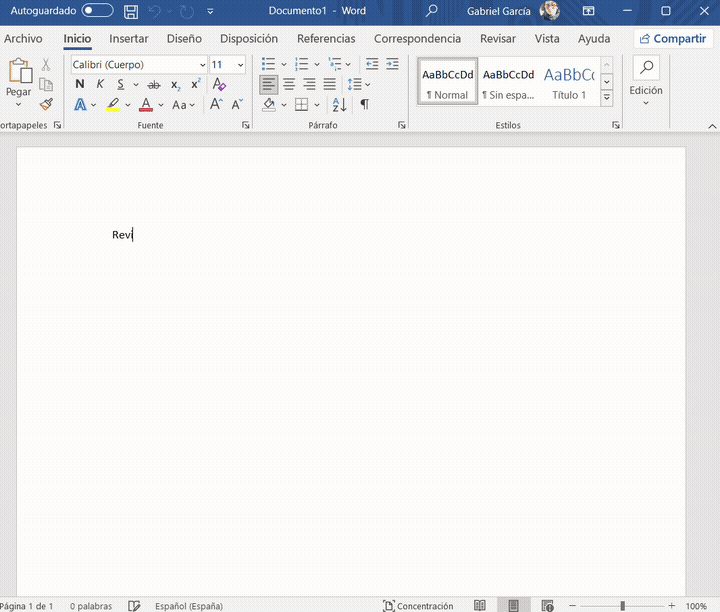

# Pluma

Pluma te deja hablar con tu agente de IA de línea de comandos (Claude Code, Codex, Gemini, Grok, Hermes o aider) desde adentro de Microsoft Word. Escribís, apretás **Alt+Enter** y la respuesta aparece debajo, en el mismo documento. No hace falta abrir ninguna otra ventana.

## Qué hace

- Elegís el agente con una mención: `@claude`, `@codex`, `@gemini`, `@grok`, `@hermes` o `@aider`.
- Desde el menú del clic derecho tenés tareas rápidas: corregir, hacerlo más formal, resumir, expandir y traducir.
- Ventana de configuración para elegir el agente, el atajo de teclado y el color de la respuesta.
- Es de solo lectura: el agente puede leer y buscar en la web, pero no ejecuta comandos ni edita archivos.

## Instalación y uso

Necesitás Windows, Word y al menos uno de esos agentes instalado. El paso a paso está en el [manual](docs/MANUAL.md).

## Contribuir

Los issues y los pull requests son bienvenidos.

## Licencia

MIT. Hecho por [@gabogabucho](https://x.com/gabogabucho).